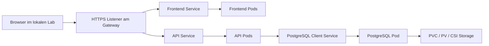
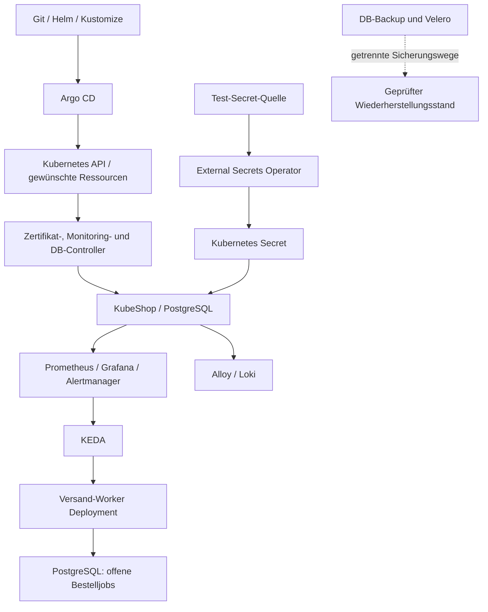

# KubeShop · Ein Projekt, acht Entwicklungsstufen

Stand: 28. Oktober 2026 · Didaktischer Ideenfundus, **noch keine implementierte Beispielanwendung**. KubeShop ist ein freiwilliger roter Faden neben anderen geeigneten Beispielen. Freiwillige Pfade und Themenideen: [Lernpfad](learning-path.md). Bestandszuordnung: [Audit](content-audit.md). Umsetzung und Migration: [Roadmap](content-roadmap.md).

## Produkt und didaktischer Vertrag

KubeShop ist ein kleiner Lernshop: Produkte ansehen, eine Testbestellung anlegen, ihren Status abfragen und später die Verarbeitung beobachten. Keine echten Zahlungen, Kundendaten, externen Maildienste oder Cloud-Konten. Ein fester Produktkatalog, erfundene Kunden und wiedererkennbare Bestell-IDs halten die Fachdomäne klein. Anwendungscode und Images werden später vorbereitet geliefert; der Kurs bewertet Kubernetes-Verständnis, keine Frontend- oder Datenbankprogrammierung.

Die Geschichte beginnt mit einem einzelnen Serverprozess. Container machen das Release transportierbar, Kubernetes betreut die Ausführung. Erst danach folgen interne Kommunikation, äußerer Zugriff, echte Persistenz, Betrieb, Automatisierung und organisatorische Anforderungen. In einer KubeShop-Erzählung bekommt eine neue Plattformkomponente einen konkreten Defekt oder eine neue Anforderung als Kontext. Eigenständige Fachlektionen brauchen keinen Shop-Bezug. „Gehört zu Enterprise“ allein ist kein Lernproblem.

Der Shop bleibt zunächst absichtlich eine Demo mit statischem Katalog. Die getrennte API kommt in K4.01 hinzu; vor K5.03 darf die Oberfläche keine dauerhafte Bestellung versprechen. In K5.01 wird Datenverlust bewusst im Modell gezeigt, in K5.03 PostgreSQL angeschlossen. Hintergrundverarbeitung kommt erst K8.04 hinzu. Keine frühe Pflicht zu Message Broker, Service Mesh, Payment-Anbindung oder vielen Microservices.

## Mögliche Architekturstände

| Lernstand / Zeitpunkt | Sichtbare Fähigkeit | Architekturänderung | Beleg und Grenze |
| --- | --- | --- | --- |
| S0 · K1.01–K1.06 | Katalog als einzelner Linux-Prozess | Prozess, Benutzer, systemd, isolierte Sichten und Ressourcenbudget | Prozess-/Netz-/Dienstbefunde erklären; Browser startet keinen Linux-Prozess |
| S1 · K1.07–K1.10 | Dasselbe Release als vorbereitetes Image | OCI-Image → containerd/CRI → Shim/runc → Prozess | Plattform- und Lifecycle-Fall lösen; kein Containerstart im Browser |
| S2 · K2.01–K2.06 | Eine nachvollziehbare Clusterumgebung | Control Plane, etcd, kubelet, Runtime, Cilium, Worker; noch kein vollständiger Shop-Stack | Bootstrap-/Fehlerbefunde richtig erklären; reale VMs separat nachweisen |
| S3 · K3.01–K3.07 | Katalog bereitstellen, aktualisieren und importieren | Pod → Deployment/ReplicaSet; ConfigMap/Secret, Probes, Requests, Job/CronJob | Replikate/Selektor im Modell prüfen; Rollouts/Probes mit erweiterten Befunden |
| S4 · K4.01–K4.07 | Frontend und API unter einer HTTPS-Testadresse | Zweites Deployment, Services/DNS, Policy, MetalLB, Gateway-Controller, TLS | Verbindungskette inkl. erlaubter/gesperrter Anfrage; noch statische API-Daten |
| S5 · K5.01–K5.05 | Bestellung bleibt nach Pod-Ersatz erhalten | PostgreSQL, StatefulSet, PVC/PV, CSI/StorageClass; Longhorn-Variante und DB-Backup | Bestell-ID vor/nach Ersatz und Restore vergleichen; Replikation ersetzt kein Backup |
| S6 · K6.01–K6.07 | Störungen erkennen und begrenzt beheben | Alloy/Loki, Prometheus Operator/Prometheus, Grafana, Alertmanager, Metrics Server/HPA, PDB | Fehler bis zur Nutzersicht verfolgen, Last und Wartung beurteilen |
| S7 · K7.01–K7.07 | Umgebungen und DB-Betrieb reproduzierbar verwalten | Helm/Kustomize, CRDs/Operatoren, Zalando, Argo CD/ApplicationSets, ESO | Git-Diff, Controllerstatus, Secret-Rotation und DB-Übernahme nachvollziehen |
| S8 · K8.01–K8.07 | Plattformziele begründen und Recovery demonstrieren | RBAC/Pod Security/Quotas/Kyverno, HA, KEDA-Worker, Velero, IaC | Rechte-/Fehler-/Restore-Tests mit bekannten Bestellungen; keine Produktionszertifizierung |

Die K-IDs beziehen sich auf den optionalen Ideenfundus in learning-path.md, nicht auf eine verbindliche Reihenfolge der drei implementierten Lernpfade. Die S-Stände sind mögliche Unterrichtsartefakte, keine Produktreleases. Jeder Stand besitzt später eigene Start-, Lösungs- und Fehlervarianten. Lernende können in einen Abschnitt einsteigen, ohne alle vorherigen Deployments lokal ausführen zu müssen. Der kleine Browserstand und ein externes Lab teilen das Problem und die erwarteten Invarianten, nicht die Behauptung identischer Laufzeit.

### Anwendungsweg ab S5

Frontend und API liegen unter derselben Shop-Adresse, etwa `/` und `/api`; der Kundenbrowser kann keine internen Cluster-DNS-Namen direkt benutzen. Service-Namen gelten für serverinterne Verbindungen. MetalLB stellt im vorgesehenen lokalen Profil die externe Service-Adresse bereit; der Gateway-Controller verarbeitet Routing. Welche Gateway-Implementierung und welche Kombination mit Cilium getestet wird, muss vor dem ausführbaren Lab festgelegt werden. Das Diagramm ist ein Zielbild, kein Abbild des heutigen Simulators.

### Betriebs- und Steuerungswege ab S7/S8

Diese Steuerungsdienste sind keine zusätzlichen synchronen Stationen jeder Shop-Anfrage. Insbesondere sind Argo CD und etcd keine Shop-Datenbank. Bestellungen bleiben PostgreSQL-Nutzdaten; ein etcd-Snapshot sichert sie nicht. HPA betreut zunächst Frontend/API; KEDA später den separaten Worker. Für dessen Replikazahl darf nicht parallel ein zweiter eigenständiger HPA oder Git-Controller konkurrierende Ziele durchsetzen.

## Komponentenregister: Problem → Einführung → Architekturwirkung

Das Register deckt die Komponentenliste der [ursprünglichen Roadmap](../architecture/roadmap.md) und alle 16 bisherigen Module ab. „Einführung“ meint erste erklärende Nutzung; „Vertiefung“ erweitert ein bekanntes Problem und erzeugt keine doppelte Anrechnung desselben Nachweises.

| Komponente / Thema | Konkretes KubeShop-Problem | Einführung | Architekturwirkung / spätere Vertiefung |
| --- | --- | --- | --- |
| Linux/Ubuntu, Prozesse | Shop-Prozess läuft/endet unklar | K1.01–K1.02 | Ausführungskontext explizit; Ubuntu-Lab K2.02 |
| Namespaces, cgroups | Instanzen sehen/stören sich | K1.03–K1.04 | Sicht und Ressourcennutzung getrennt; Requests/QoS K3.05 |
| systemd | Dienst startet nach Reboot nicht | K1.05 | Prozessbetreuung auf Node-Ebene; Runtime-Dienst K2.02 |
| Linux-Netzwerk, DNS/TCP | Lokaler Zugriff klappt, entfernter nicht | K1.06 | Listener/Route/Name als getrennte Grenzen |
| OCI, Images/Registry | Release oder Plattform passt nicht | K1.07 | Unveränderlicher Inhaltsverweis und reproduzierbare Eingaben |
| containerd, Shim, runc | Image vorhanden, kein Prozess | K1.08 | Verwaltung und Ausführung trennen |
| CRI, crictl, Sandbox | kubelet erreicht erwartete Runtime nicht | K1.09 | Schnittstellenvertrag; kubelet-Lifecycle K3.04 |
| Linux-VMs, kind | Dedizierte sichere Übungsumgebung fehlt | K2.02 | Getrennte Profile: Mehrnode-Bootstrap vs. schneller Anwendungscluster |
| kubeadm, Zertifikate, kubeconfig | Koordination/Vertrauen fehlt | K2.03 | Control Plane initialisiert; Wartung/Rotation K6.06 |
| kube-apiserver | Änderungen brauchen einen gemeinsamen Vertrag | K2.01, K2.03 | API als Koordinationsgrenze; Schreibpfad K2.05 |
| etcd | Gewünschter Clusterzustand muss erhalten bleiben | K2.03, K2.05 | Koordinationsdaten persistiert; Raft/HA/Restore K8.03 |
| kube-scheduler | Neue Shop-Pods brauchen geeignete Nodes | K2.01, K2.03 | Rollenmodell zunächst; Constraints/Bind K3.05 |
| kube-controller-manager | Soll/Ist muss wiederholt abgeglichen werden | K2.01, K2.03 | Rollenmodell zunächst; Reconciliation K3.02/K7.03 |
| kubelet/Worker Join | Gewünschte Pods müssen lokal ausgeführt werden | K2.04 | Registrierung/Status und lokale Betreuung; Probes K3.04 |
| Cilium/CNI/eBPF | Pods verschiedener Nodes erreichen sich nicht | K2.04 vorbereitet | Paketweg K4.03; Policy K4.04; keine allgemeine eBPF-Programmierpflicht |
| Pod, Namespace, Labels | Shop-Ausführung ist nicht deklarativ beschrieben | K2.01/K3.01 | Kubernetes-Identität und kleinste Workload-Einheit |
| Deployment, ReplicaSet | Ein Pod-Ausfall reduziert den Dienst dauerhaft | K3.02 | Replikaziel und Ersatz; Rollout K3.06 |
| ConfigMap, Secret | Einstellungen/Zugangsdaten stecken im Image | K3.03 | Konfiguration getrennt; Secret ist kein automatischer Verschlüsselungs-/Rotationsbeweis |
| Startup/Readiness/Liveness | Running-Pod liefert noch Fehler | K3.04 | Bereitschaft und Neustart getrennt |
| Requests/Limits/QoS, Affinity/Taints/Spread | Shop passt nicht auf jeden Node | K3.05 | Platzierung und Ressourcenbudget; Ausfallreserve K8.03 |
| Job, CronJob | Import ist keine Dauerschleife | K3.07 | Abgeschlossene/zeitgesteuerte Arbeit, idempotente Wiederholung |
| Service, EndpointSlice | Pod-Adressen wechseln | K4.01 | Stabile interne Zielwahl; Ports und Readiness als eigene Fehlergrenzen |
| CoreDNS | API soll über Namen erreichbar sein | K2.04 vorbereitet, K4.02 erklärt | Namensauflösung; DNS ist keine Verbindungsgarantie |
| NetworkPolicy, Hubble | Fremder Client darf API nicht nutzen | K4.04 | Zulässige Verkehrsbeziehungen und Beobachtung ihrer Entscheidung |
| MetalLB | Lokaler Cluster hat keine externe Service-IP | K4.05 | Lokale LoadBalancer-Adresse; keine bezahlte Infrastruktur |
| Gateway API + Controller, Ingress | Frontend/API brauchen gemeinsames HTTP-Routing | K4.06 | Listener/Route/Backend; Ingress als Vergleich/Migrationspfad |
| cert-manager | TLS-Bereitstellung/Erneuerung wird fehleranfällig | K4.07 | Certificate/Issuer-Controller; Test-CA ohne öffentliche Domain |
| emptyDir, PV, PVC, CSI, StorageClass | Pod-Ersatz löscht Bestellungen | K5.01–K5.02 | Lebensdauer/Provisionierung entkoppelt; Topologie mit Scheduling verknüpft |
| StatefulSet, Headless Service, PostgreSQL | DB braucht stabile Identität und Daten | K5.03 | Zunächst Einzelinstanz mit PVC; kein behauptetes DB-HA |
| Longhorn | Storage hängt an einer Node-Disk | K5.04 | Verteilte Volume-Replikate; zusätzliche Ressourcen/Fehlerdomänen |
| PostgreSQL-Backup/Restore | Logischer Datenfehler repliziert sich mit | K5.05 | Getrennte Sicherung und Bestellprüfung; später Operator/WAL/PITR |
| DaemonSet, Grafana Alloy, Loki | Logs verschwinden mit Pods | K6.02 | Node-Sammlung und zentraler Logpfad im Lab |
| Prometheus Operator, Prometheus, Grafana | Keine belastbare Messung der Shop-Gesundheit | K6.03 | CR-basierte Zielkonfiguration, Messung und Dashboard |
| Alertmanager | Fehler werden erst durch Nutzer gemeldet | K6.04 | Gruppierung/Routing von Alarmen; lokaler Sink statt externer Nachricht |
| Metrics Server, HPA | Statische Replikazahl passt nicht zur Last | K6.05 | Ressourcenmetriken und Skalierungsregel; Node-Kapazität bleibt begrenzt |
| PDB, Drain, Upgrades | Wartung unterbricht zu viele Replikate | K6.06 | Geplante Unterbrechung mit Budget; keine Ausfallgarantie |
| Helm | Installation ist eine fehleranfällige Sammlung von Dateien | Vorbereitete Nutzung K2.04; erklärt K7.01 | Paket/Values/Release; frühere Installationen nachvollziehbar machen |
| Kustomize | Umgebungskopien laufen auseinander | K7.02 | Gemeinsame Basis und gezielte Änderungen |
| CRDs, Controller, Finalizer | Fachzustände brauchen eigenen Betriebsvertrag | Nutzung K4.07/K6.03; erklärt K7.03 | Erweiterte API und kontinuierliche Betreuung, kein Controller-Autorentool nötig |
| Zalando Postgres Operator | DB-Instanzen manuell betreuen skaliert nicht | K7.04 | Betreiberverantwortung an Operator übergeben; PostgreSQL/Patroni-Aufgaben abgrenzen |
| Argo CD | Laufender Stand weicht von Git ab | K7.05 | Deklaratives Ausrollen/Abgleich; nicht zugleich App-Datenrollback |
| ApplicationSets | Mehrere Umgebungen sollen kontrolliert folgen | K7.06 | Generierung separater Applications mit begrenztem Zielumfang |
| External Secrets Operator | Secret-Rotation ist vom Git-Release abhängig | K7.07 | Externe Quelle → Kubernetes Secret → Verbraucher als drei getrennte Schritte |
| RBAC, ServiceAccounts, Roles/ClusterRoles | App/Team besitzt zu viele Rechte | Grundschutz K3.03; erklärt K8.01 | Begrenzter API-Zugriff; Namespace, Netz und Pod-Sicherheit bleiben separat |
| Pod Security, SecurityContext, Quotas/LimitRange | Ein Team gefährdet gemeinsame Ressourcen | K8.01 | Ausführungs- und Budgetregeln zusätzlich zu RBAC |
| Kyverno | Ungültige/unsichere Releases werden zugelassen | K8.02 | Policy/Admission und Berichte; Ausnahme- und Ausfallkonzept |
| HA, API-LB, etcd-Quorum, Leases | Einzelne Control Plane fällt aus | K8.03 | Mehrere Koordinatoren und Fehlerdomänen; nicht nur mehr App-Replikate |
| KEDA | Offene Versandjobs passen nicht zur CPU-Last | K8.04 | Eigener Worker und ereignisbezogene Skalierung, getrennt vom API-HPA |
| Velero | Ganze Umgebung muss wiederhergestellt werden | K8.05 | Ressourcen-/Volume-Sicherung neben DB-Sicherung und Git |
| OpenTofu / Terraform, Ansible | Lab-Nodes lassen sich nicht reproduzieren | K8.06 | Lokale Infrastrukturdefinition und Node-Konfiguration; kein Plattform-Agent |
| Troubleshooting / Recovery | Einzelprüfungen ergeben noch keine Diagnose | K2.06, K6.07, K8.07 | Zunehmend offene Fälle mit Nutzersicht und Gegenbelegen |

## Verbindende Aufgaben statt isolierter Demos

Eine ausdrücklich als KubeShop-Fortsetzung gestaltete Lektion benennt bei Bedarf den vorherigen S-Stand, die relevante Änderung und die neue Fähigkeit. Andere Lektionen verwenden ein passenderes Beispiel oder eine eigenständige Fragestellung. Beispiel: K4.04 darf DNS nicht versehentlich sperren, während sie unerlaubte API-Clients blockiert. K5.03 muss eine bereits angelegte Testbestellung nach Pod-Ersatz wiederfinden. K7.05 darf einen erfolgreichen Git-Sync nicht als erfolgreichen Checkout ausgeben.

Kapitelübergaben besitzen ein kleines Belegpaket: Architekturansicht, Ressourcenauszug, bekannte Testdaten, erwartete positive/negative Anfrage, Modellgrenze und Reset-Ziel. Neue Fehlervarianten ändern Labels, Ports oder Befundreihenfolge; sie belohnen die Invariante statt Auswendiglernen des bisherigen Klickpfads. Eine alternative korrekte Lösung wird akzeptiert, wenn sie Aufgabenvertrag und Gegenproben erfüllt. Bei Auswahlaufgaben wird ausdrücklich nur Ursachenwahl bewertet; freie Begründungen bekommen eine Vergleichsrubrik statt vorgetäuschter automatischer Bewertung.

### Vorbereitete Anwendungsartefakte für die spätere Umsetzung

- Kleine Frontend-/API-/Worker-Versionen mit klaren Health-/Metrics-Endpunkten, deterministischen Testdaten und dokumentiertem Verhalten bei DB-Ausfall; keine echten Zahlungen oder Nachrichten.
- Vollständige Start-/Lösungsmanifeste sowie gezielt defekte Varianten je Unterrichtsstand, mit stabilen Labels, Ports, Image-Digests und Versionsmatrix. Reine Fragmente ausdrücklich markieren.
- Katalogimport zunächst ohne DB; nach K5.03 vorbereitetes DB-Importartefakt. Datenmigrationen dürfen die Kubernetes-Aufgabe nicht verstecken.
- Übergang Einzel-PostgreSQL → Zalando-betreute DB als **Datenmigration in getrenntes Ziel** mit Backup, Rückweg und Integritätsprüfung. Kein gleichzeitiger Besitz desselben StatefulSets/PVC durch Handkonfiguration und Operator.
- Statische Befundpakete für Browserarbeit und getrennte echte Testprotokolle. Keine erfundenen Logs als gemessene Ausgabe kennzeichnen.
- Ein isolierter Shop-Lab-Speicher je Stand/Versuch; freie Playground-Entwürfe werden nicht überschrieben. Bestehende `hello-kubelab`-/Teamboard-Artefakte bleiben als Legacy-Szenarien erhalten.

## Kostenfreie Spezialfälle und offene Lab-Entscheidungen

ESO bietet einen Fake-Provider mit statischen Schlüssel/Wert-Paaren. Er eignet sich für den Lernvertrag ohne bezahlten Secret-Dienst; er demonstriert keine produktionsreife externe Geheimnisverwaltung. Die Wahl des Browser-/Lab-Profils ist eine didaktische Ableitung aus der [offiziellen Providerbeschreibung](https://external-secrets.io/latest/provider/fake/).

KEDA kann Prometheus als Triggerquelle verwenden. Deshalb kann der vorbereitete Shop eine Rückstandsmetrik für PostgreSQL-basierte Arbeit anbieten, ohne einen zusätzlichen Message Broker in diesen Beispielpfad einzuführen. Metrikvertrag, Aktivierung und Ausfallverhalten müssen im konkreten Lab überprüft werden. Grundlage: [KEDA Prometheus Scaler](https://keda.sh/docs/2.21/scalers/prometheus/); die verlinkte Dokumentationsversion ist noch keine gewählte Lab-Version.

Velero unterscheidet Volume-Sicherungswege und hat dabei konkrete Backend-/Volume-Grenzen. Deshalb plant der Kurs eine Abdeckungsmatrix und separate DB-Konsistenzprüfung. Lokales Backup-Backend, CSI-/Dateisicherung und unterstützte Volume-Typen werden vor dem Lab festgelegt; kein pauschales „Velero sichert alles“. Grundlage: [Velero File System Backup](https://velero.io/docs/v1.18/file-system-backup/).

Weitere offene Entscheidungen sind Gateway-Controller, geprüfte Versionskombinationen und Hardwareprofile für Longhorn/DB/Monitoring. Die Redaktion muss sie vor ausführbaren Anleitungen entscheiden und testen; sie blockieren den browserbasierten Inhaltsentwurf nicht. Externe Downloads können Internet benötigen; GitHub-Pages-Kompatibilität bedeutet nicht automatisch Offlinefähigkeit.
